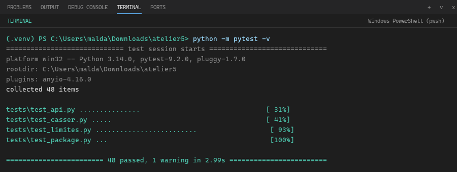
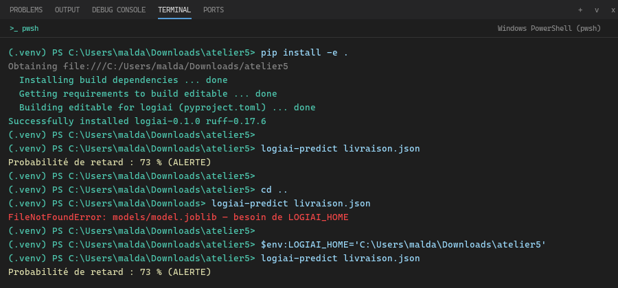
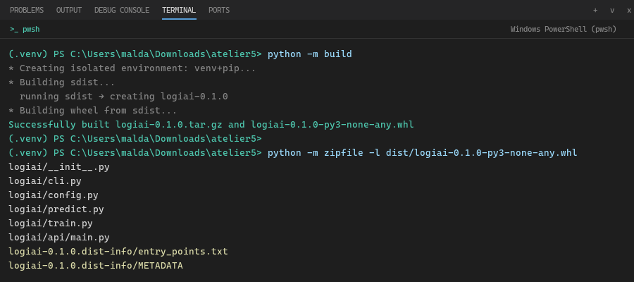
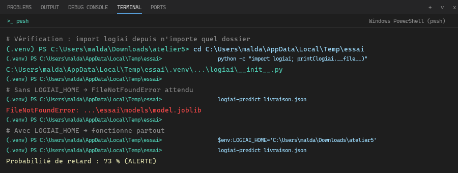
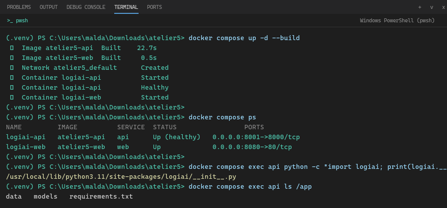
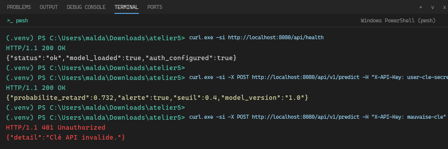

# Compte Rendu : Atelier 6 — Faire de LogiAI un package Python installable

**Réalisé par :** Maldani Mostafa  
**Module :** Développement et déploiement d’applications intelligentes  
**Professeur :** Pr. Soukaina Gouraguine  
**Année Universitaire :** 2026 - 2027  
**Branche Git :** `tp6`  

---

## Étape 1 · Constater le problème

- Depuis la racine du projet : `python -c "import logiai; print(logiai.__file__)"` affiche `C:\Users\malda\Downloads\atelier5\logiai\__init__.py`.
- Depuis le dossier parent (`cd ..`) : l'import échoue avec `ModuleNotFoundError: No module named 'logiai'`.
- **Phrase :** *« Pour utiliser LogiAI, mon collègue doit obligatoirement se placer dans le dossier du projet ou modifier manuellement son `PYTHONPATH`, car LogiAI n'est pas encore installé comme package dans l'environnement Python. »*



---

## Étapes 2 & 3 · `pyproject.toml` et installation éditable (`pip install -e ".[api,dev]"`)

- Création de [`pyproject.toml`](pyproject.toml) avec les dépendances cœur (`pandas>=2.0`, `numpy`, `scikit-learn>=1.3`, `joblib`), les extras `api` et `dev`, et `[tool.setuptools.packages.find] include = ["logiai*"]`.
- Création de [`tests/test_package.py`](tests/test_package.py).
- Après `pip install -e ".[api,dev]"`, `pip show logiai` affiche `Version: 0.1.0` et `import logiai` fonctionne depuis `cd ..`.

---

## Étape 4 · Commande CLI `logiai-predict`

- Création de [`logiai/cli.py`](logiai/cli.py) et déclaration `logiai-predict = "logiai.cli:main"` sous `[project.scripts]` dans [`pyproject.toml`](pyproject.toml).
- `logiai-predict livraison.json` affiche : **`Probabilité de retard : 73 % (ALERTE)`**.
- **Suite de tests :** `48 passed` (`pytest -v`).



### Question : `pluie_mm = 500`
- **La commande `logiai-predict`** répond `Probabilité de retard : 73 % (ALERTE)` sans erreur.
- **L'API (`/v1/predict`)** répond **`422 Unprocessable Entity`** (`Input should be less than or equal to 100`).
- **Pourquoi ?** L'API valide les entrées via le schéma Pydantic [`Livraison`](logiai/api/schemas.py) (`pluie_mm: float = Field(..., ge=0.0, le=100.0)`), alors que la CLI appelle directement `Predictor().predict(...)` sans validation Pydantic.

---

## Étape 5 · Construire le wheel et le livrer à un collègue

- `python -m build` génère `dist/logiai-0.1.0-py3-none-any.whl`.
- `python -m zipfile -l dist/logiai-0.1.0-py3-none-any.whl` montre uniquement `logiai/` et `logiai-0.1.0.dist-info/` (ni `models/`, ni `data/`, ni `tests/`, ni `.env`).
- Mise à jour de [`logiai/config.py`](logiai/config.py) : `ROOT = Path(os.environ.get("LOGIAI_HOME", Path.cwd()))`.



### Simulation collègue dans `%TEMP%\essai`
1. **Premier lancement (sans `LOGIAI_HOME`) :** échoue avec :  
   `FileNotFoundError: [Errno 2] No such file or directory: 'C:\Users\malda\AppData\Local\Temp\essai\models\model.joblib'` *(normal : le modèle n'est pas dans le wheel)*.
2. **Deuxième lancement (avec `LOGIAI_HOME=C:\Users\malda\Downloads\atelier5`) :** affiche **`Probabilité de retard : 73 % (ALERTE)`**.



---

## Étape 6 · Installer le package dans l'image Docker

- Dans [`Dockerfile`](Dockerfile), remplacement de `COPY logiai/ ./logiai/` par :
  ```dockerfile
  COPY pyproject.toml /tmp/build/
  COPY logiai/ /tmp/build/logiai/
  RUN pip install --no-cache-dir --no-deps /tmp/build && rm -rf /tmp/build
  ```
- Après `docker compose up -d --build` :
  - `docker compose ps` : `logiai-api` (`healthy`) et `logiai-web` (`Up`).
  - `docker compose exec api python -c "import logiai; print(logiai.__file__)"` → **`/usr/local/lib/python3.11/site-packages/logiai/__init__.py`**.
  - `docker compose exec api ls /app` → `data`, `models`, `requirements.txt` (pas de dossier `logiai/`).




---

## Étape 7 · Livrables & Ticket de sortie

- **ADR 005 :** [`docs/adr/005-packaging.md`](docs/adr/005-packaging.md)
- **Étude de conception (architecture) :** [`docs/etude-de-conception.md`](docs/etude-de-conception.md)

### Ticket de sortie (individuel)
1. **Docker et le package : quelle différence ?**  
   Le package Python (`wheel`) distribue uniquement le code Python et ses métadonnées pour un environnement Python ; Docker empaquette tout le système d'exécution isolé (OS Linux, Python, dépendances exactes, configuration, serveur web/API).
2. **`pip install -e .` ou `wheel` : lequel pour développer, lequel pour livrer ?**  
   `pip install -e .` (mode éditable) pour développer (modifications prises en compte immédiatement sans réinstaller) ; `wheel` (`.whl`) pour livrer une version figée et reproductible.
3. **Qu'est-ce qui n'est pas dans le wheel, et que faut-il livrer avec ?**  
   `models/` (`model.joblib`, `model_info.json`), `data/`, `.env` et `tests/` ne sont pas dans le wheel. Il faut livrer le modèle et la configuration (`LOGIAI_HOME`, variables `.env`) à côté.
4. **Qu'est-ce qui reste flou pour vous ?**  
   La gestion des dépendances optionnelles (`extras`) et le multi-stage build pour réduire encore la taille de l'image Docker finale.
